# 🐍 Python Data Analytics Assessment: Functional Logic, Dictionary Comprehensions, NumPy & Pandas (Quiz 04)

<div align="center">

[](https://colab.research.google.com/github/islamyasser424-design/Python-Quiz-04/blob/main/Python_Quiz_04.ipynb)
[](https://www.python.org/)
[](https://numpy.org/)
[](https://pandas.pydata.org/)
[](https://jupyter.org/)
[]()
[](https://islamyasser424-design.github.io/portfolio-/)

<p align="center">
  <strong>A rigorous technical assessment benchmarking core competencies across the modern Python data analytics stack: Modular Functional Logic, Declarative Dictionary Comprehensions, Vectorized NumPy Matrix Manipulation, and Production-Grade Pandas DataFrame Transformation Pipelines.</strong>
</p>

</div>

---

## 📑 Table of Contents
- [Executive Summary & Analytics Relevance](#-executive-summary--analytics-relevance)
- [Curriculum & Architectural Roadmap](#-curriculum--architectural-roadmap)
- [System Architecture & Processing Flow](#-system-architecture--processing-flow)
- [Comprehensive Task Inventory & Solutions](#-comprehensive-task-inventory--solutions)
  - [Task 1: Student Grade Analyzer (Functions & Dictionaries)](#task-1-student-grade-analyzer-functions--dictionaries)
  - [Task 2: Inventory Price Update (Dictionary Comprehensions & Conditional Logic)](#task-2-inventory-price-update-dictionary-comprehensions--conditional-logic)
  - [Task 3: NumPy Array Reshaping & Slicing (Vectorized Matrix Computing)](#task-3-numpy-array-reshaping--slicing-vectorized-matrix-computing)
  - [Task 4: Pandas DataFrame Filtering & Feature Engineering (Tabular Analytics)](#task-4-pandas-dataframe-filtering--feature-engineering-tabular-analytics)
- [Software Engineering Best Practices & Memory Efficiency](#-software-engineering-best-practices--memory-efficiency)
- [Repository Structure](#-repository-structure)
- [Getting Started & Google Colab Execution](#-getting-started--google-colab-execution)
- [الدليل البرمجي والتشغيلي الشامل (باللغة العربية)](#-الدليل-البرمجي-والتشغيلي-الشامل-باللغة-العربية)
- [Author & Professional Connect](#-author--professional-connect)

---

## 📌 Executive Summary & Analytics Relevance

In modern data analytics and business intelligence workflows, Python serves as the critical bridge connecting raw transactional systems to executive insight dashboards. A robust data professional must be equally adept at:
1. **Low-Level Procedural & Functional Logic**: Transforming nested JSON payloads, API response dictionaries, and unstructured collections into clean data mappings.
2. **Pythonic Declarative Idioms**: Leveraging dictionary and list comprehensions to write expressive, self-documenting, and memory-efficient transformation logic.
3. **High-Performance Vectorized Computing (NumPy)**: Manipulating continuous numerical memory blocks, performing multidimensional matrix indexing, and running zero-overhead mathematical operations.
4. **Relational & Tabular Data Engineering (Pandas)**: Implementing multi-condition Boolean filtering, defensive explicit copying (`.copy()`), feature engineering, and deterministic ranking/sorting.

This repository (**Python-Quiz-04**) captures an end-to-end evaluation that tests these exact four pillars through practical, production-inspired scenarios.

---

## 🎯 Curriculum & Architectural Roadmap

The assessment is architected into four progressive tiers that mirror real-world data engineering and analytical workflows:

| Tier | Module | Core Python / Library Feature | Real-World Analog |
| :--- | :--- | :--- | :--- |
| **01** | **Functional Aggregation** | `def`, dictionary iteration, dynamic list averages | Aggregating user event metrics / API response parsing |
| **02** | **Declarative Transformation** | Dictionary Comprehension with inline filtering | E-Commerce pricing rules & catalog discount engines |
| **03** | **Multidimensional Computing** | `np.random.seed`, `.reshape()`, 2D index slicing | Image pixel processing, tensor prep, statistical simulation |
| **04** | **Tabular Feature Engineering** | `pd.DataFrame`, compound Boolean masks, derived metrics | HR workforce analytics, payroll adjustments & bonus allocation |

---

## 🏛️ System Architecture & Processing Flow

The following Mermaid architectural diagram visualizes the data flow and transformation pipelines evaluated across all four tasks:

```mermaid
flowchart TD
    subgraph S1["Tier 1: Core Functional Aggregation"]
        A1["Raw Nested Student Data<br/>dict[str, list[int]]"] --> B1["analyze_student_grades()"]
        B1 --> C1["Compute Arithmetic Mean<br/>sum(scores) / len(scores)"]
        C1 --> D1{"Score >= 60?"}
        D1 -- Yes --> E1["Filtered Passed Cohort<br/>dict[name: average]"]
        D1 -- No --> F1["Excluded (< 60)"]
    end

    subgraph S2["Tier 2: Declarative Comprehension Engine"]
        A2["Store Catalog Dictionary<br/>dict[Item: BasePrice]"] --> B2["Dictionary Comprehension"]
        B2 --> C2{"Base Price > 500?"}
        C2 -- Premium Item --> D2["Apply 15% Markdown<br/>price * 0.85"]
        C2 -- Budget Item --> E2["Filter Out (<= 500)"]
        D2 --> F2["Discounted Premium Catalog"]
    end

    subgraph S3["Tier 3: Vectorized Numerical Computing (NumPy)"]
        A3["Random Seed (42)"] --> B3["np.random.randint(10, 101, 12)<br/>1D Vector (Shape: 12,)"]
        B3 --> C3["Matrix Reshaping<br/>.reshape(3, 4)"]
        C3 --> D3["2D Slicing: [:2, -2:]<br/>Rows 0..1 & Last 2 Cols"]
        D3 --> E3["Extracted Sub-Matrix (2x2)"]
    end

    subgraph S4["Tier 4: Enterprise Tabular Engineering (Pandas)"]
        A4["Raw Enterprise Records<br/>Name, Dept, Salary, Exp"] --> B4["pd.DataFrame()"]
        B4 --> C4["Compound Boolean Filter<br/>(Exp >= 3) & (Salary > 6000)"]
        C4 --> D4["Explicit Memory Copy<br/>.copy() to isolate view"]
        D4 --> E4["Feature Engineering<br/>Annual_Bonus = Salary * 0.10"]
        E4 --> F4["Deterministic Sorting<br/>.sort_values('Salary', asc=False)"]
        F4 --> G4["Executive HR Payroll Dataset"]
    end
```



---

## 🧪 Comprehensive Task Inventory & Solutions

### Task 1: Student Grade Analyzer (Functions & Dictionaries)

#### Business Context & Objective
Academic institutions and e-learning platforms continuously monitor learner cohorts. The goal is to build an automated evaluation function `analyze_student_grades(student_data)` that calculates individual student performance and isolates qualifying students based on a passing benchmark ($\ge 60\%$).

#### Technical Implementation
```python
def analyze_student_grades(student_data):
    """
    Calculates the average grade for each student and filters for passing students.
    
    Parameters:
        student_data (dict): Mapping of student names (str) to score lists (list[int]).
        
    Returns:
        dict: Filtered mapping of student names to their calculated float average (>= 60).
    """
    passed_students = {}

    for name, scores in student_data.items():
        if not scores:
            continue  # Defensive guard against empty grade lists
        average = sum(scores) / len(scores)

        if average >= 60:
            passed_students[name] = average

    return passed_students
```

#### Test Verification & Data Execution
```python
# Input Cohort
students_input = {
    "Ahmed": [55, 60, 65],
    "Sara": [85, 90, 95],
    "Omar": [40, 45, 50],
    "Mona": [70, 75, 80]
}

# Execution
result = analyze_student_grades(students_input)
print("Passed Students Averages:")
print(result)
```

**Output:**
```json
Passed Students Averages:
{'Ahmed': 60.0, 'Sara': 90.0, 'Mona': 75.0}
```

* **Outcome Analysis**: 
  - **Ahmed**: Average $= (55+60+65)/3 = 60.0$ $
ightarrow$ **Passed** (Meets exact boundary condition).
  - **Sara**: Average $= (85+90+95)/3 = 90.0$ $
ightarrow$ **Passed** (High honors).
  - **Omar**: Average $= (40+45+50)/3 = 45.0$ $
ightarrow$ **Filtered Out** ($< 60$).
  - **Mona**: Average $= (70+75+80)/3 = 75.0$ $
ightarrow$ **Passed**.

---

### Task 2: Inventory Price Update (Dictionary Comprehensions & Conditional Logic)

#### Business Context & Objective
In e-commerce merchandising, promotional markdown engines apply targeted percentage discounts exclusively to premium tier merchandise. The task requires filtering out commodity goods ($\le \$500$) and applying a $15\%$ discount (`price * 0.85`) to premium goods using clean, single-pass dictionary comprehension.

#### Technical Implementation
```python
# Raw Retail Catalog
store_inventory = {
    "Laptop": 15000,
    "Mouse": 250,
    "Keyboard": 600,
    "USB Cable": 150,
    "Monitor": 4000
}

# Declarative Dictionary Comprehension: Filtering + Transformation in O(N)
discounted_items = {
    item: price * 0.85
    for item, price in store_inventory.items()
    if price > 500
}

print("Discounted Premium Items:")
print(discounted_items)
```

**Output:**
```json
Discounted Premium Items:
{'Laptop': 12750.0, 'Keyboard': 510.0, 'Monitor': 3400.0}
```

#### Analytical Breakdown
| Catalog Item | Original Price | Status ($> 500$) | Formula Applied | Discounted Price |
| :--- | :--- | :--- | :--- | :--- |
| **Laptop** | \$15,000 | ✅ Premium | $\$15,000 	imes 0.85$ | **\$12,750.0** |
| **Mouse** | \$250 | ❌ Excluded | Excluded by predicate | *N/A* |
| **Keyboard** | \$600 | ✅ Premium | $\$600 	imes 0.85$ | **\$510.0** |
| **USB Cable** | \$150 | ❌ Excluded | Excluded by predicate | *N/A* |
| **Monitor** | \$4,000 | ✅ Premium | $\$4,000 	imes 0.85$ | **\$3,400.0** |

* **Code Optimization Note**: The dictionary comprehension executes in a single pass ($O(N)$ time, $O(K)$ space where $K \le N$), avoiding the memory overhead of intermediate lists.

---

### Task 3: NumPy Array Reshaping & Slicing (Vectorized Matrix Computing)

#### Business Context & Objective
Scientific simulations, spatial analyses, and algorithmic features require manipulating raw numeric vectors into structured 2D matrices. This problem tests deterministic random number generation, tensor reshaping, and multi-axis coordinate slicing.

#### Step-by-Step Technical Implementation
```python
import numpy as np

# 1. Deterministic Pseudo-Random Seed for Reproducibility
np.random.seed(42)

# 2. Generate 1D vector of 12 integers in range [10, 100]
numbers = np.random.randint(10, 101, 12)

# 3. Reshape 1D vector into 3x4 2D matrix
matrix = numbers.reshape(3, 4)

print("Original 3x4 Matrix:")
print(matrix)

# 4. Multidimensional Slicing:
#    - First 2 rows: [:2] (indices 0 and 1)
#    - Last 2 columns: [-2:] (indices -2 and -1)
sub_matrix = matrix[:2, -2:]

print("
Extracted Sub-Matrix (First 2 rows, Last 2 columns):")
print(sub_matrix)
```

**Execution Output:**
```text
Original 3x4 Matrix:
[[61 24 81 70]
 [30 92 96 84]
 [84 97 33 12]]

Extracted Sub-Matrix (First 2 rows, Last 2 columns):
[[81 70]
 [96 84]]
```

#### Dimensional & Slicing Architecture
```
Original Matrix (3 Rows x 4 Columns):
                  Col 0    Col 1    Col 2    Col 3
                ┌────────┬────────┬────────┬────────┐
Row 0 (Idx 0)   │   61   │   24   │ [ 81 ] │ [ 70 ] │  <-- Row selected (:2)
                ├────────┼────────┼────────┼────────┤
Row 1 (Idx 1)   │   30   │   92   │ [ 96 ] │ [ 84 ] │  <-- Row selected (:2)
                ├────────┼────────┼────────┼────────┤
Row 2 (Idx 2)   │   84   │   97   │   33   │   12   │  <-- Omitted
                └────────┴────────┴────────┴────────┘
                                      ▲        ▲
                               Col -2 (2)  Col -1 (3)
```

* **NumPy Performance Insight**: Slicing an existing array via `matrix[:2, -2:]` generates a memory **view** rather than allocating a full data copy, operating in instantaneous $O(1)$ time complexity without additional RAM consumption.

---

### Task 4: Pandas DataFrame Filtering & Feature Engineering (Tabular Analytics)

#### Business Context & Objective
Human Resources and Operations leaders often analyze enterprise compensation across divisions. This exercise requires building a structured DataFrame, applying compound conditional filtering, preventing memory reference warnings, engineering a derived bonus metric, and ranking employees by salary.

#### Technical Implementation
```python
import pandas as pd

# 1. Define Raw Organizational Records
data = {
    "Name": ["Ali", "Fatma", "Hassan", "Zainab", "Khaled"],
    "Department": ["IT", "HR", "IT", "Finance", "IT"],
    "Salary": [5000, 8000, 12000, 7500, 9000],
    "Experience": [2, 4, 5, 3, 1]
}

# 2. Instantiate DataFrame
df = pd.DataFrame(data)

# 3. Compound Boolean Filtering with Explicit Copy
#    Criteria: Experience >= 3 years AND Salary > $6,000
filtered_df = df[
    (df["Experience"] >= 3) & (df["Salary"] > 6000)
].copy()

# 4. Feature Engineering: Derive 10% Annual Bonus
filtered_df["Annual_Bonus"] = filtered_df["Salary"] * 0.10

# 5. Deterministic Ranking: Sort by Salary descending
filtered_df = filtered_df.sort_values(by="Salary", ascending=False)

print("Enterprise Qualified Talent & Compensation Ledger:")
print(filtered_df)
```

**Execution Output:**
```text
Enterprise Qualified Talent & Compensation Ledger:
     Name Department  Salary  Experience  Annual_Bonus
2  Hassan         IT   12000           5        1200.0
1   Fatma         HR    8000           4         800.0
3  Zainab    Finance    7500           3         750.0
```

#### Detailed Eligibility Matrix
| Employee | Dept | Salary | Exp | Condition 1 (`Exp >= 3`) | Condition 2 (`Salary > 6000`) | Final Status | Annual Bonus ($10\%$) | Rank |
| :--- | :--- | :--- | :--- | :--- | :--- | :--- | :--- | :--- |
| **Ali** | IT | \$5,000 | 2 yrs | ❌ False (2) | ❌ False (\$5,000) | **Excluded** | — | — |
| **Fatma** | HR | \$8,000 | 4 yrs | ✅ True (4) | ✅ True (\$8,000) | **Retained** | **\$800.0** | **#2** |
| **Hassan**| IT | \$12,000 | 5 yrs | ✅ True (5) | ✅ True (\$12,000) | **Retained** | **\$1,200.0**| **#1** |
| **Zainab**| Finance| \$7,500 | 3 yrs | ✅ True (3) | ✅ True (\$7,500) | **Retained** | **\$750.0** | **#3** |
| **Khaled**| IT | \$9,000 | 1 yr | ❌ False (1) | ✅ True (\$9,000) | **Excluded** | — | — |

---

## 🛡️ Software Engineering Best Practices & Memory Efficiency

Throughout this codebase, key software engineering and data analysis design principles are rigorously demonstrated:

1. **Defensive Slicing with `.copy()`**:
   ```python
   # Anti-Pattern (Triggers SettingWithCopyWarning on subsequent mutations):
   filtered_df = df[(df["Experience"] >= 3) & (df["Salary"] > 6000)]
   filtered_df["Bonus"] = ... # WARNING! Modifying a view of original df

   # Best Practice (Explicit memory separation):
   filtered_df = df[(df["Experience"] >= 3) & (df["Salary"] > 6000)].copy()
   ```

2. **Deterministic Reproducibility (`np.random.seed(42)`)**:
   Setting an explicit seed guarantees that matrix outputs and statistical simulations yield identical values across development environments, automated unit tests, and production CI/CD pipelines.

3. **Vectorized Feature Engineering vs Loops**:
   Computing `filtered_df["Salary"] * 0.10` utilizes Pandas' underlying C-optimized SIMD vectorization. This outperforms row-by-row `.iterrows()` or `.apply()` by several orders of magnitude on large-scale datasets.

4. **Comprehension Elegance & Expressiveness**:
   Replacing 6-line imperative initialization and append loops with concise dictionary comprehensions reduces cognitive load and eliminates boilerplate code.

---

## 📁 Repository Structure

```plaintext
Python-Quiz-04/
├── .gitignore              # Standard Python, Jupyter, virtualenv & OS ignore rules
├── LICENSE                 # MIT License (2026 Islam Yasser)
├── Python_Quiz_04.ipynb    # Primary Jupyter Notebook with all 4 executed tasks
└── README.md               # Executive bilingual documentation & architectural guide
```

---

## 🚀 Getting Started & Google Colab Execution

### Run in the Cloud (1-Click)
Launch the notebook directly in your browser without local configuration:
[](https://colab.research.google.com/github/islamyasser424-design/Python-Quiz-04/blob/main/Python_Quiz_04.ipynb)

### Run Locally

1. **Clone the Repository**:
   ```bash
   git clone https://github.com/islamyasser424-design/Python-Quiz-04.git
   cd Python-Quiz-04
   ```

2. **Create and Activate a Virtual Environment**:
   ```bash
   # Windows (PowerShell)
   python -m venv venv
   .\venv\Scripts\Activate.ps1

   # Linux / macOS
   python3 -m venv venv
   source venv/bin/activate
   ```

3. **Install Dependencies**:
   ```bash
   pip install numpy pandas jupyterlab
   ```

4. **Launch Jupyter Lab**:
   ```bash
   jupyter lab Python_Quiz_04.ipynb
   ```

---

## 📖 الدليل البرمجي والتشغيلي الشامل (باللغة العربية)

### ما هو تقييم Python-Quiz-04؟
يمثل هذا المشروع تقييماً عملياً شاملاً صُمم لقياس الكفاءات الجوهرية التي يحتاجها مهندس ومحلل البيانات (Data Analyst / Analytics Engineer) للتعامل باحترافية مع البيانات عبر لغة بايثون، والانتقال السلس من التفكير البرمجي الإجرائي الكلاسيكي إلى أحدث مكتبات التحليل الرقمي والحسابي المتجه (Vectorized Computing).

---

### المحاور الأساسية الأربعة للمشروع:

#### 1. دالة تحليل وتصفية درجات الطلاب (`Student Grade Analyzer`):
* **الهدف التقني:** بناء دالة برمجية معيارية `analyze_student_grades` تستقبل قاموساً بأسماء الطلاب وقوائم درجاتهم.
* **آلية المعالجة:**
  - حساب المتوسط الحسابي لكل طالب ديناميكياً عن طريق جمع الدرجات وقسمتها على عددها.
  - تطبيق شرط التصفية (فلترة الناجحين الحاصلين على $\ge 60$ فقط).
  - إرجاع قاموس جديد نظيف يحوي الأسماء ومتوسطات الدرجات المطابقة للشرط.

#### 2. محرك تحديث الأسعار والخصومات الذكية (`Inventory Price Update`):
* **الهدف التقني:** استخدام أسلوب **Dictionary Comprehensions** المتقدم لكتابة كود بايثوني مختصر وفائق السرعة لتحديث أسعار المتجر.
* **آلية المعالجة:**
  - استبعاد المنتجات الاقتصادية ذات السعر الأقل من أو يساوي 500.
  - تطبيق خصم تجاري بنسبة 15% على المنتجات المتميزة الباقية في سطر برمجي واحد وبدورة معالجة واحدة $O(N)$.

#### 3. تشكيل وتقطيع مصفوفات NumPy ثنائية الأبعاد (`NumPy Reshaping & Slicing`):
* **الهدف التقني:** توليد بيانات رقمية عشوائية قابلة للتكرار وتشكيلها في صورة مصفوفة ثنائية الأبعاد، ثم استخلاص أجزاء محددة منها بدقة.
* **آلية المعالجة:**
  - تثبيت البذرة العشوائية `np.random.seed(42)` لضمان مطابقة النتائج عند إعادة التشغيل.
  - توليد متجه أحادي الأبعاد مكون من 12 رقماً بين 10 و 100، وإعادة تشكيله لمصفوفة أبعادها $3 	imes 4$.
  - استقطاع أول صفين مع آخر عمودين باستخدام الفهرسة المركبة `matrix[:2, -2:]` مع الاستفادة من ميزة الـ Memory View السريعة في NumPy.

#### 4. هندسة ميزات وتصفية أطر بيانات Pandas (`Pandas DataFrame Engineering`):
* **الهدف التقني:** بناء إطار بيانات للموظفين، وتطبيق شروط مركبة، وتوليد أعمدة مشتقة، والترتيب التنازلي.
* **آلية المعالجة:**
  - تصفية الموظفين ذوي الخبرة $\ge 3$ سنوات وراتب يتجاوز 6,000 جنيه/دولار باستخدام الأقواس المنطقية المركبة `(Exp >= 3) & (Salary > 6000)`.
  - استخدام `.copy()` لفصل الذاكرة كأفضل ممارسة معتمدة لمنع تحذيرات `SettingWithCopyWarning`.
  - اشتقاق عمود مكافأة الأداء السنوية `Annual_Bonus = Salary * 0.10` بأسلوب متجه وسريع.
  - إعادة ترتيب السجلات تنازلياً حسب الراتب للحصول على تقرير رواتب قيادي دقيق.

---

## 👨‍💻 Author & Professional Connect

**Islam Yasser**  
*Data Analyst & Business Intelligence Specialist*

* **Portfolio Website**: [islamyasser424-design.github.io/portfolio-/](https://islamyasser424-design.github.io/portfolio-/)
* **LinkedIn**: [linkedin.com/in/islam-yasser-55048b378](https://www.linkedin.com/in/islam-yasser-55048b378/)
* **GitHub Profile**: [github.com/islamyasser424-design](https://github.com/islamyasser424-design)

---

<div align="center">
  <sub>Built with precision, data discipline, and clean functional programming standards. © 2026 Islam Yasser.</sub>
</div>
